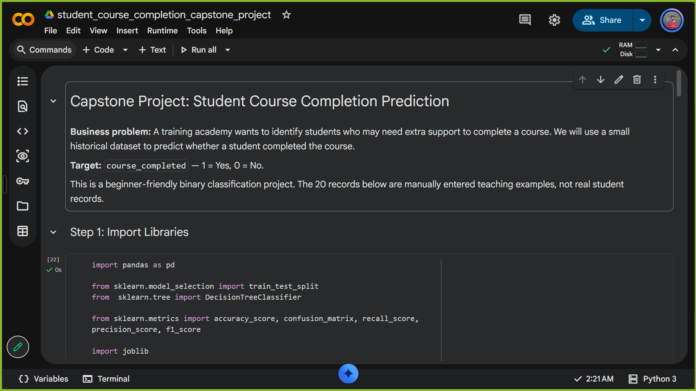
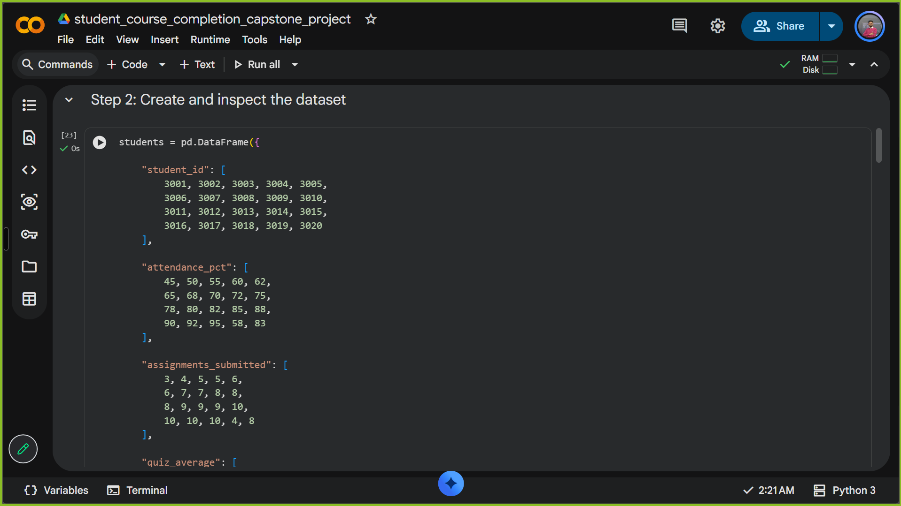
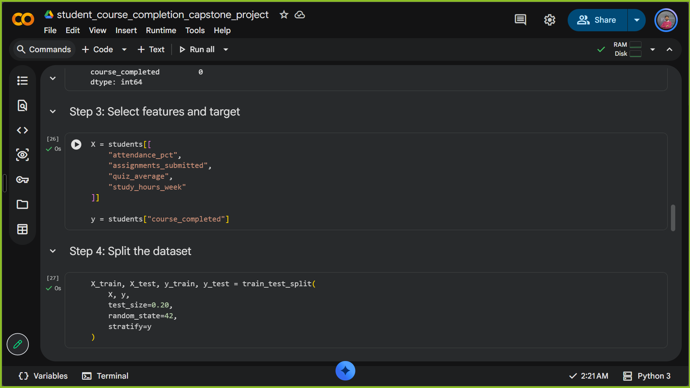
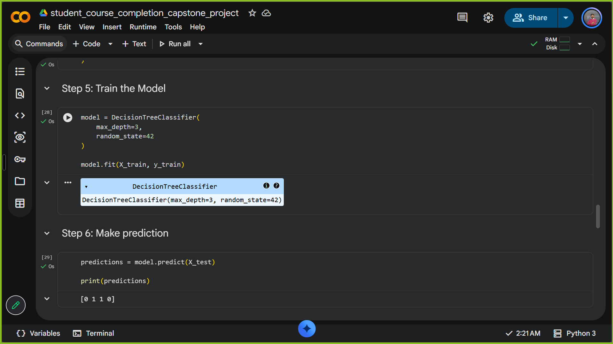
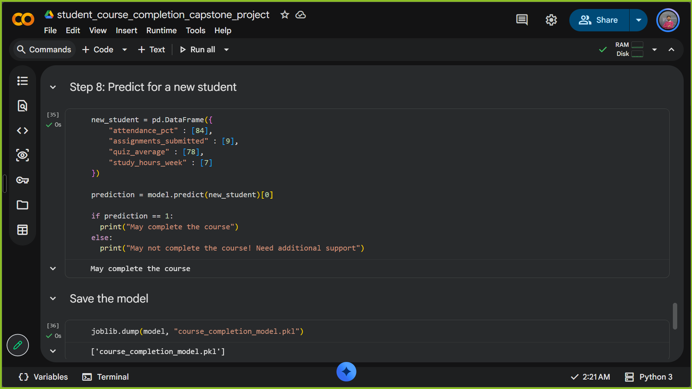

# Student Course Completion Prediction

Can student activity help identify who might need extra support to finish a course? This beginner data science project explores that question with a decision tree classifier built in Python.

The notebook walks through the full workflow: creating a small dataset, selecting features, training a model, evaluating predictions, and saving the trained model.

---

## 📚 Dataset

The dataset contains **20 manually entered teaching examples**, not real student records. Each row describes a student using:

| Feature | Description |
| --- | --- |
| `attendance_pct` | Attendance percentage |
| `assignments_submitted` | Number of assignments submitted |
| `quiz_average` | Average quiz score |
| `study_hours_week` | Study hours per week |

The target is `course_completed`: **1** means completed and **0** means not completed. `student_id` is included in the dataset but is not used as a model feature.

## 🌳 Model and results

The notebook uses a `DecisionTreeClassifier` with a maximum depth of 3. The data is split into 80% training and 20% testing, with stratification and a fixed random state.

| Metric | Test result |
| --- | ---: |
| Accuracy | 100% |
| Precision | 100% |
| Recall | 100% |
| F1 score | 100% |

The confusion matrix is `[[2, 0], [0, 2]]`. These results come from just **four test examples** in a small, manually created dataset. They demonstrate the workflow, but they do not establish how well the model would perform on real students.

---

## 🛠️ Tools

- Python and Jupyter Notebook
- pandas for working with the dataset
- scikit-learn for training and evaluation
- joblib for saving the model

## 🚀 Run the notebook

1. Clone or download this repository and open a terminal in the project folder.
2. Install the dependencies:

   ```bash
   pip install pandas scikit-learn joblib notebook
   ```

3. Start Jupyter Notebook:

   ```bash
   jupyter notebook
   ```

4. Open `student_course_completion_capstone_project.ipynb` and run the cells in order.

The dataset is created inside the notebook, so no separate data download is needed. Running the final cell saves the trained model as `course_completion_model.pkl` in the working directory.

## 📸 Notebook screenshots











---

## 👤 Author

**Ankit Kumar**
